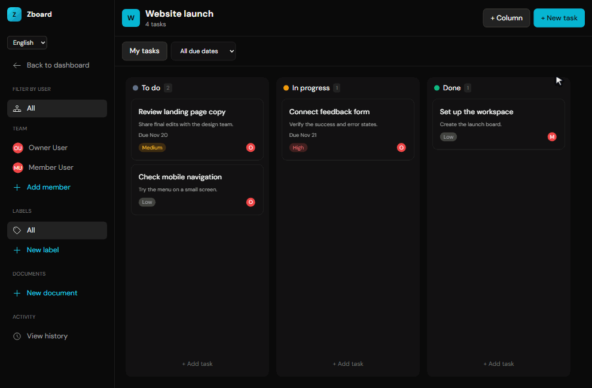

# Zboard

Zboard is a Kanban board for teams. Organize projects in workspaces, move tasks through custom columns, and use labels, assignees, and project documents to keep track of the work.

The frontend is built with Nuxt and can be deployed as a static site. The included Supabase setup provides PostgreSQL, authentication, and the data API. Each deployment uses its own database and user accounts.

## Demo



## Quick start

**Requirements** — Node.js 22, pnpm 10, and a new Supabase project with email sign-in enabled.

1. In the Supabase SQL Editor, run [`001_schema.sql`](database/001_schema.sql), [`002_supabase.sql`](database/002_supabase.sql), and [`003_project_management.sql`](database/003_project_management.sql) in that order. Run each script once on a fresh database.
2. Create a local `.env` file using `.env.example` as a template. Set `NUXT_PUBLIC_SUPABASE_URL` to your project URL and `NUXT_PUBLIC_SUPABASE_KEY` to your publishable key. A legacy `anon` key also works. Keep database passwords and Supabase secret or `service_role` keys server-side.
3. In Supabase **Authentication → URL Configuration**, set the **Site URL** to your app's origin and add `http://localhost:3000/auth/login` to the allowed redirect URLs for local development.
4. From the repository root, install dependencies and start the development server.

```bash
pnpm install --frozen-lockfile
pnpm dev
```

Open `http://localhost:3000`, create an account, and confirm your email if required. Create a workspace and a project to open a board with four starter columns.

[Nuxt Supabase configuration](https://supabase.nuxtjs.org/getting-started/introduction) · [Supabase Auth redirect URLs](https://supabase.com/docs/guides/auth/redirect-urls)

## Database setup

| File | Purpose |
| --- | --- |
| [`database/001_schema.sql`](database/001_schema.sql) | Creates the application tables, relationships, constraints, and indexes, and enables row-level security. |
| [`database/002_supabase.sql`](database/002_supabase.sql) | Connects the schema to Supabase Auth and adds access policies, database functions, and triggers. |
| [`database/003_project_management.sql`](database/003_project_management.sql) | Adds project archiving, workspace invitations and member removal, and task due dates. |
| [`database/tests/smoke_supabase.sql`](database/tests/smoke_supabase.sql) | Checks setup and access with temporary users. |
| [`database/tests/smoke_project_management.sql`](database/tests/smoke_project_management.sql) | Checks project permissions, invitation acceptance, member removal, and due dates. |

Run the smoke tests in a test project after all three setup scripts. Each test rolls back its data.

| Tables | Purpose |
| --- | --- |
| `profiles`, `workspaces`, `workspace_members` | User profiles, workspace ownership, and membership. |
| `projects`, `task_statuses`, `tasks` | Projects, board columns, and task cards. |
| `labels`, `task_labels`, `task_assignees` | Task labels and assignees. |
| `project_documents` | Project documents that can be referenced from tasks. |
| `task_activities`, `notifications` | Task history and private notifications. |

`add_workspace_member` lets a workspace owner add a confirmed account by email. `save_board_task` validates labels and assignees and saves the task and its assignments in a single transaction. Database triggers create workspace owner memberships and starter columns, keep profiles in sync, record task activity, and send assignment notifications.

[Supabase row-level security](https://supabase.com/docs/guides/database/postgres/row-level-security)

### Projects, invitations, and due dates

Workspace owners can edit, archive, and restore projects from the dashboard. Archived projects live under **Archived projects** and are excluded from active dashboard counts. Their boards and tasks are still accessible. Workspace owners can also remove members from workspace settings. Removing a member clears their task assignments in that workspace and preserves task history.

In workspace settings, choose **Create invitation** to get a link for a specific email address. Copy the link or use **Open email draft** to compose a message in your email app. The recipient opens the link, signs in or registers with the invited address, confirms the address if required, and accepts the invitation. Links expire after seven days and can be used once. Generating another link for the same address replaces the previous one.

Add an optional due date in the task editor. You can combine **My tasks** with **Overdue** or **Due this week**. The week runs from Monday to Sunday in your local calendar. The overdue filter excludes completed tasks.

### Using another PostgreSQL provider

Apply `001_schema.sql` to a fresh PostgreSQL 14 or later database. It provides the application schema with row-level security enabled. The second script depends on Supabase Auth and its database roles.

To run Zboard against a different provider, connect the frontend to a compatible API or build a backend that manages authentication, maps identities to `profiles.id`, and enforces workspace access. Use the additional scripts as a reference for the data operations, database functions, and triggers your backend needs. Store `DATABASE_URL` on the server.

### Upgrading an existing database

If you already applied `001_schema.sql` and `002_supabase.sql`, run `003_project_management.sql` once before deploying this frontend. Existing projects start as active and existing tasks have an empty due date. If your deployment uses a customized schema, check the migration against a copy first.

## Deployment

Set the two public Supabase environment variables on your hosting service and build the site.

```bash
pnpm generate
```

Publish `.output/public` and configure the host to serve `index.html` for app routes that do not resolve to a file. [`netlify.toml`](netlify.toml) includes this setup for Netlify. Set the production origin as the Supabase **Site URL** and allow `https://your-domain.example/auth/login` as a redirect. Rebuild the site when switching Supabase projects.
